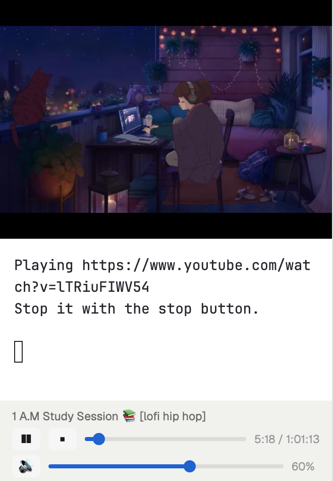

# Arix

A Herdr layout with a YouTube player in the left sidebar. See [RECIPE.md](RECIPE.md) for what it does and how to install it.



## Windows setup

Run these in PowerShell. Herdr's home is `%USERPROFILE%\.config\herdr-app`.

1. **Install the programs the player runs:**

   ```powershell
   winget install --id Python.Python.3.12 -e
   winget install --id yt-dlp.yt-dlp -e
   winget install --id junegunn.fzf -e
   winget install --id shinchiro.mpv -e
   ```

   The mpv installer doesn't add itself to PATH, so add it to your user PATH:

   ```powershell
   $u = [Environment]::GetEnvironmentVariable('Path', 'User')
   [Environment]::SetEnvironmentVariable('Path', "$u;C:\Program Files\MPV Player", 'User')
   ```

2. **Restart Herdr.** Until then it still has the old PATH, `python` opens the Microsoft Store stub and the controls do nothing.

3. **Copy the mods and the layout into Herdr's home:**

   ```powershell
   git clone https://github.com/arixpsy/herdr-arix
   $h = "$HOME\.config\herdr-app"
   Copy-Item herdr-arix\mods\yt-video, herdr-arix\mods\yt-controls "$h\mods" -Recurse -Force
   Copy-Item herdr-arix\layouts\arix.json "$h\layouts\arix.json"
   herdr-app check "$h\mods\yt-video"
   herdr-app check "$h\mods\yt-controls"
   ```

4. **Start the player terminal.** The wrapper reloads PATH from the registry, so it also works if Herdr's core started before the installs:

   ```powershell
   $inner = '$env:Path=[Environment]::GetEnvironmentVariable(''Path'',''Machine'')+'';''+[Environment]::GetEnvironmentVariable(''Path'',''User''); python -B "$HOME\.config\herdr-app\mods\yt-controls\player.py"'
   hc run --json --bg --keep --no-parent --no-notify --outlive-parent --name youtube --cwd $HOME -- powershell -NoProfile -NoLogo -Command $inner
   ```

   It prints the terminal's address, for example `{"address":"t13",...}`.

5. **Put that address in the layout.** In `%USERPROFILE%\.config\herdr-app\layouts\arix.json`, set the `youtube` block's `"terminal"` to the address, then switch to the layout:

   ```powershell
   herdr-app do layout.switch --name arix
   herdr-app status   # "errors" should be []
   ```

When the player's terminal ends, Herdr removes the `youtube` block from the layout. To get it back, repeat steps 4 and 5.
