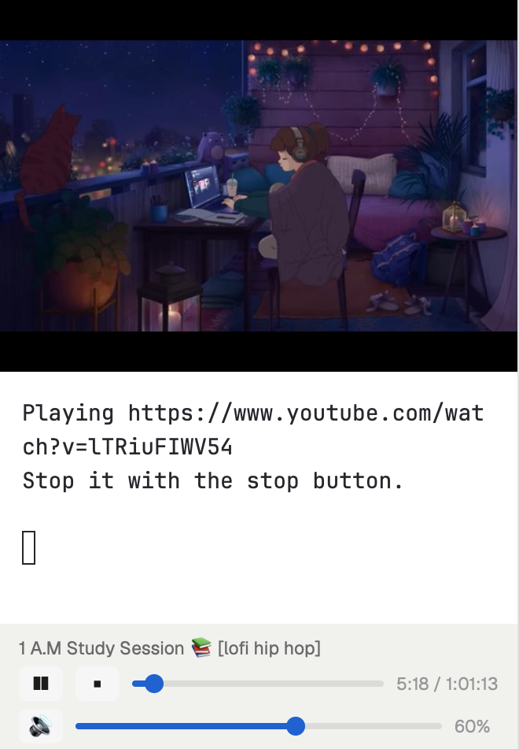

# Arix

Herdr's main layout with a YouTube player in the left sidebar. The player stays on screen in every space and tab. You search or paste a URL in a small terminal, pick a result with fzf, and the video plays above it at about 8 fps. Play/pause, stop, a draggable seek bar and a volume bar sit below the terminal.

## What you see

The window matches Herdr's `main` layout, with three blocks added to the left sidebar under the agents list. From top to bottom:

1. **Video**, 152px tall (`yt-video`). It shows the current frame on black, scaled to fill the block. With nothing playing, it shows "Search below to play a video" in the theme's `dim` color on `chrome`.
2. **Player terminal**, 220px tall, at least 160px (`youtube`). Its prompt reads `YouTube [vo=sidebar]  search or URL (v=cycle video mode):`. While a video plays, it shows `Playing <url>`.
3. **Controls**, 82px tall (`yt-controls`), on `chrome`, padded 12px by 6px:
   - The title on one line, 11.5px, truncated. It reads "Nothing playing" when idle.
   - A row with a play/pause button (`▶` or `❚❚`), a stop button (`■`), a seek bar and `m:ss / m:ss`.
   - A row with a mute button (`🔊` or `🔇`), a volume bar and the volume percent.
   - The buttons are 28 by 22px, `raised`, and turn `hover` on hover.
   - The bars are a 4px `border` track with an `accent` fill and a 12px round knob. Both bars turn `dim` while nothing plays.

The layout sets no theme, so it follows yours.

## How it behaves

- At the prompt, type a search and press Enter. The player lists 20 YouTube results in fzf. Enter plays the selected result, and Escape goes back.
- A line that starts with `http` plays that URL directly.
- `v` cycles the video mode: `sidebar`, `window` (a floating 480x270 mpv window, top right), `tct` (text art in the terminal), and `null` (audio only).
- Play/pause toggles pause. Stop quits mpv and brings the prompt back.
- Press on a bar, drag, and release to seek or set the volume. Nothing changes until you release. Pressing outside the controls cancels a drag.
- The controls ask mpv for its state every 500ms.
- If a video fails, the player tries YouTube's HLS streams. If those fail too, the terminal shows mpv's last error lines and waits for Enter.
- Agent statuses look exactly as in Herdr's `agents` mod, which this layout reuses.

## Built from

- **Layout.** `layouts/arix.json` is a clone of `main` 0.1.12. Its `sidebar-lists` column holds `spaces` and `agents` (weight 1 each, min 90), then `yt-video` (`{"px":152}`), `youtube` (`{"terminal":"<address>"}`, `{"px":220}`, min 160) and `yt-controls` (`{"px":82}`). Everything else is the shipped `workspace-chrome`, `spaces`, `agents`, `tabs`, `pane`, `files`, `changes` and `workspace-status` mods.
- **`mods/yt-video`** is a mod with `"place": "none"`. It draws `image("mods/yt-video/frame.jpg")` while `shared("yt.playing")` is true, and the hint otherwise.
- **`mods/yt-controls`** is a mod with `"place": "none"`. It runs `python3 -B mods/yt-controls/mpvctl.py <cmd>` through `exec` (`python` on Windows, chosen with `window().platform`). It sets `setShared("yt.playing", ...)` from the reply.
- **`mpvctl.py`** sends JSON commands to mpv's IPC server, the commands being `state`, `toggle`, `seek <sec>`, `volume <0-100>`, `mute` and `stop`. The server is `~/.cache/ytplayer/mpv.sock` on macOS and Linux, and the named pipe `\\.\pipe\ytplayer-mpv` on Windows.
- **`player.py`** runs in the `youtube` terminal. It searches with `yt-dlp --flat-playlist "ytsearch20:<q>"`, picks with `fzf`, and plays with `mpv`. In sidebar mode, mpv writes JPEG frames (`--vo=image`, `--vf=fps=12,scale=540:-2`, quality 85) into `~/.cache/ytplayer/frames`. A thread moves the second-newest frame onto `mods/yt-video/frame.jpg` with an atomic rename every 30ms, then deletes the older frames.
- **Programs it runs:** `python3`, `mpv`, `yt-dlp` and `fzf`. **It reaches the network:** YouTube, through yt-dlp and mpv. **It writes outside its folder:** `~/.cache/ytplayer/` and `ytplayer.log` in the system temp folder.

## Watch out

- **The terminal block needs a terminal from this machine.** Start the player first, then put the printed address in the `youtube` block:
  - macOS and Linux: `hc run --json --bg --keep --no-parent --no-notify --outlive-parent --name youtube --cwd ~ -- python3 -B ~/.config/herdr-app/mods/yt-controls/player.py`
  - Windows: the same with `python` and the Windows path to `mods\yt-controls\player.py` under Herdr's home.
- **Herdr removes a terminal block from the layout when its terminal ends.** After killing or restarting the player, add the `youtube` block back with the new address.
- **Keep one frame file name.** Herdr keeps every image it has shown under a new name, or with new content under a new path, for as long as it runs, about 1.2 MB per frame. Rewriting one file in place doesn't grow memory. The cost is that Herdr's file watcher shows about 8 fps.
- **Don't use mpv's Kitty output in a Herdr terminal.** Herdr never frees Kitty images, so memory grows about 45 MB a second.
- **Run Python with `-B`.** Every file change under a mod's folder reloads that mod, and that includes a new `__pycache__` folder.
- **A mod's timers don't fire between reloads.** `yt-video` redraws on every frame because `frame.jpg` changes, so it reads `shared("yt.playing")` instead of polling.
- **On Windows, `python3` opens the Microsoft Store.** Use `python`. Windows also refuses the rename while Herdr reads `frame.jpg`, and the player skips that frame. Windows is untested.
- **YouTube answers 403 on the direct streams of some videos** and drops the HLS streams of others, which is why the player tries both. Keep yt-dlp updated (`yt-dlp -U`, `brew upgrade yt-dlp` or `winget upgrade yt-dlp.yt-dlp`).
- **Install first.** macOS: `brew install mpv yt-dlp fzf`. Windows: `winget install Python.Python.3.12 yt-dlp.yt-dlp junegunn.fzf`, plus mpv from mpv.io with `mpv` on PATH. The prompt lists any program that is missing.

## Done when

- `herdr-app check` passes for `mods/yt-video` and `mods/yt-controls`.
- `layout.switch {"name":"arix"}` shows the three player blocks under the agents list, and no `layout.error` file appears.
- Pasting a YouTube URL plays the video in the sidebar within about 15 seconds, and the controls show its title and duration.
- Searching "lofi" lists 20 results in fzf.
- Pause, a seek to 0:30 and volume 40 each show up in `python3 -B mods/yt-controls/mpvctl.py state`.
- Stop brings back the hint and the prompt, and deletes `frame.jpg`.
- Herdr's memory stays within a few MB over a minute of playback.
- No `__pycache__` folder appears under `mods/yt-controls`.
